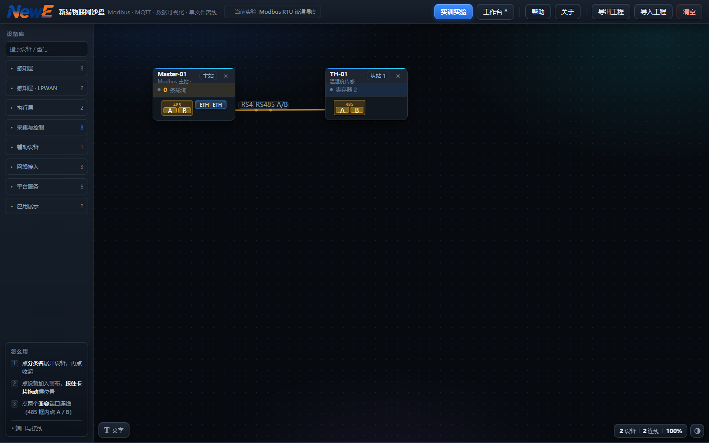
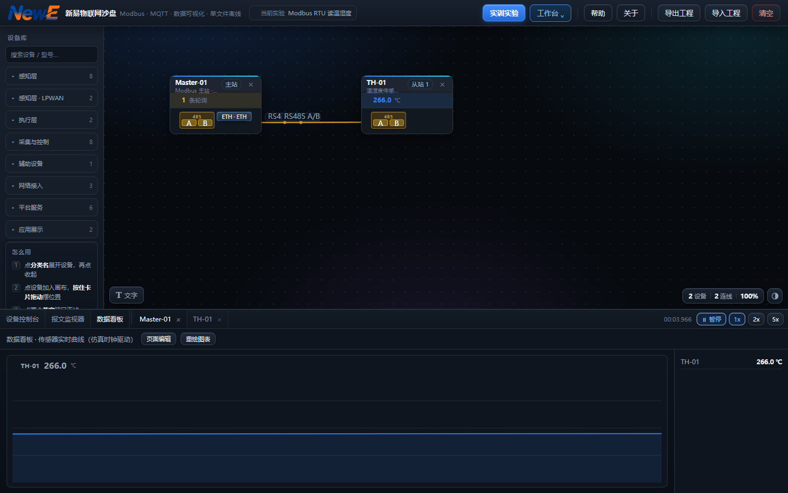
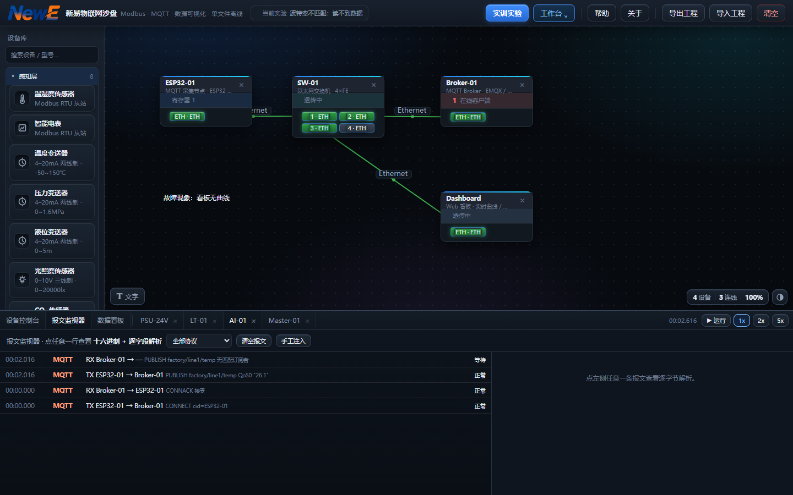
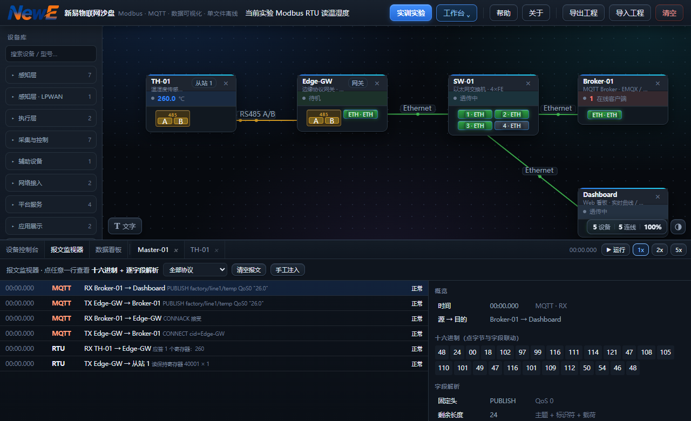
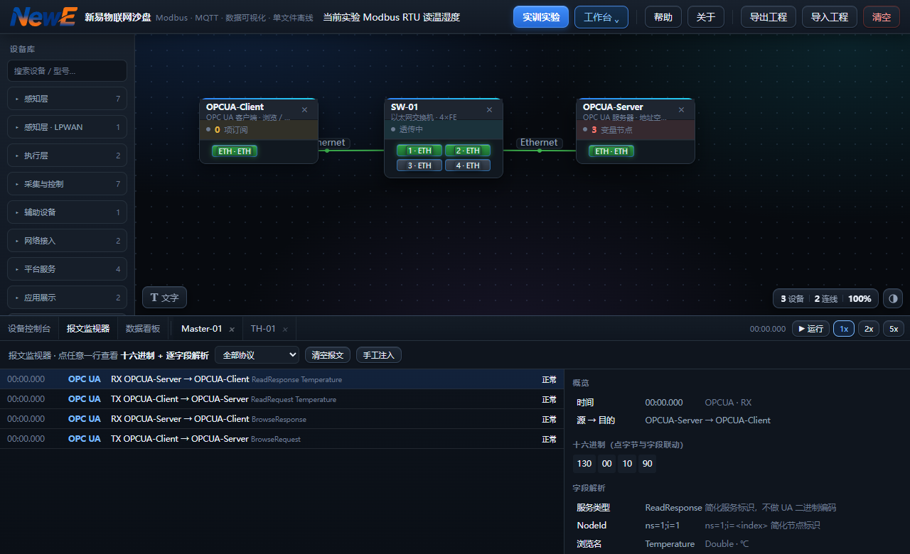
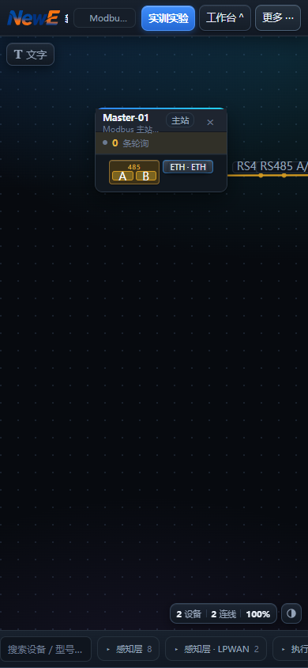

<h1 align="center">新易物联网沙盘 · NE_IOTSIM</h1>

<p align="center">
  <b>拖几个设备、连一根线、敲一条命令 —— 让物联网协议在你眼前跑起来。</b><br/>
  单文件、零安装、完全离线的物联网教学仿真器。
</p>

<p align="center">
  <a href="https://liuyimr.github.io/NE_IOT/"></a>
  <a href="https://github.com/liuyimr/NE_IOT/releases"></a>
  
  
  
  <a href="./LICENSE"></a>
</p>

---

## 为什么做这个？

工业现场和物联网课上，协议总是"看不见"的：

- Modbus 的 CRC 到底怎么算？帧里每个字节是什么意思？
- MQTT 的 QoS 0/1/2 握手差别，讲十遍不如看一遍帧序列。
- LoRa 的 SF、占空比，为什么包发不出去？
- BACnet 的 AI/AV 对象，只读和可写到底差在哪？

**NE_IOTSIM 把这些协议变成可以动手玩的东西**：拖设备搭拓扑、点端口连线、在控制台敲命令，报文监视器逐字节解析，数据看板实时出曲线。不用装环境、不用买硬件、不联网，双击一个 HTML 文件就能开始。

> 面向：物联网 / 工业自动化 / 楼宇智能化教学，也适合工程师快速验证协议概念。
> 教学模拟器，不是真实协议栈；不连真实 Broker、不开真实串口、不采集真实数据。

---

## 亮点

| 特性 | 说明 |
|---|---|
| **单文件交付** | 一个 ~350 KB 的 HTML，自带全部 CSS/JS/图标，拷到 U 盘就能用 |
| **10 类协议/信号** | Modbus RTU/TCP、MQTT、OPC UA、LoRaWAN、NB-IoT、CoAP、BACnet/IP、标准信号、模拟量输出、网关转换 |
| **报文监视器** | 逐字节解析，按协议 / 按当前设备过滤，主从站收发一目了然 |
| **23 个实训实验** | 从接线到排错，含预置故障：断线、波特率不匹配、Topic 写错、占空比超限 |
| **故障注入与手工报文注入** | `crc bad on` / `fault break` / `drop`，或直接构造十六进制帧看解析变化 |
| **可视化页面编辑器** | 数值卡 / 仪表 / 曲线 / 状态灯，绑定任意数据系列，一键导出独立 HTML 看板 |
| **每设备参数面板** | 双击设备直接改量程 / 幅度 / 周期 / 地址 / Topic，规则表、映射表可视化增删，与命令双向同步 |
| **连线三点交互** | 悬停看两端设备端口，单击选中，拖动改接，右键 / × / Del 删除 |
| **手机 / 平板可用** | 横向设备库、手势缩放、响应式工作台，课堂上用手机也能演示 |
| **类 VRP 命令行** | 简洁命令，`help` 随时查，Tab 自动补全 |

---

## 截图

<table>
  <tr>
    <td width="50%"><br/><b>主界面 · 拓扑搭建与报文监视</b></td>
    <td width="50%"><br/><b>实时曲线看板</b></td>
  </tr>
  <tr>
    <td><br/><b>MQTT QoS 握手逐帧解析</b></td>
    <td><br/><b>Modbus → MQTT 转换前后帧并列</b></td>
  </tr>
  <tr>
    <td><br/><b>OPC UA 地址空间与服务帧</b></td>
    <td><br/><b>手机端 · 横向设备库与画布手势</b></td>
  </tr>
</table>

---

## 30 秒上手

1. 打开 **[在线演示](https://liuyimr.github.io/NE_IOT/)**，或下载 [`NE_IOTSIM.html`](NE_IOTSIM.html) 双击打开。
2. 点顶栏 **实训实验** → 加载「Modbus RTU 读温湿度」。
3. 点 **▶ 运行**，双击画布上的 `Master-01`，输入：
   ```
   poll 1 40001 2 every 600
   ```
4. 切到 **报文监视器** 看 `01 03 00 00 00 02 C4 0B` 的逐字节解析；切到 **数据看板** 看温度曲线。

想试 MQTT？加载「Broker 连接与 Topic 规划」，双击节点输入 `connect`，再 `pub factory/line1/temp 26.5 -q 1 -r`。

完整教程见 **[使用说明.md](使用说明.md)**。

---

## 协议一览

| 协议 | 仿真内容 |
|---|---|
| **Modbus RTU / TCP** | 完整帧结构、CRC16、MBAP 头、多从站轮询、01/03/05/06 功能码 |
| **MQTT 3.1.1** | CONNECT/CONNACK、PUBLISH、SUBSCRIBE、QoS 0/1/2 握手、Retain、LWT、通配符 |
| **OPC UA**（简化） | 地址空间变量节点、Browse / Read / Subscribe / Publish |
| **LoRaWAN**（简化） | 入网、Class A 上行、SF/BW、FCnt、RSSI/SNR、占空比 |
| **NB-IoT**（简化） | RSRP/SINR、速率/时延、PSM 深睡与唤醒 |
| **CoAP**（简化） | REST 资源、GET/POST、Observe 订阅 |
| **BACnet/IP**（简化） | 对象属性模型、ReadProperty / WriteProperty、AI 只读 AV 可写 |
| **标准信号** | 4–20mA 两线制、0–10V 三线制、AI/AO 模块、断线/短路/超量程 |
| **边缘网关** | Modbus 寄存器 → MQTT Topic 映射，比例换算，前后帧并列 |
| **报文注入** | 五协议十六进制帧手工构造与实时解析 |

---

## 设备与实验

**30+ 设备类型**：传感器/变送器、继电器、AO 模块、Modbus 主站/PLC、边缘网关、交换机、MQTT Broker、规则引擎、OPC UA 服务器/客户端、LoRa 节点/网关/服务器、NB-IoT 节点/基站、CoAP 服务器/节点、BACnet 设备/客户端、Web 看板、可视化终端……

**23 个实验**，分组覆盖：标准信号接入、Modbus 串口、工业以太网、执行输出、MQTT 平台、排错实训、OPC UA、LPWAN 与网关、报文注入、Web 与楼宇协议。

---

## 文档

- [使用说明.md](使用说明.md)：界面导览、五步闭环、10 类协议实操、故障排查清单、页面导出、FAQ
- [在线演示](https://liuyimr.github.io/NE_IOT/)：直接用浏览器体验

---

## 仓库结构（发布包）

```
.
├── NE_IOTSIM.html    # 成品：单文件离线仿真器（下载版）
├── docs/index.html   # GitHub Pages 入口（与成品相同）
├── assets/           # README 截图
├── README.md
├── 使用说明.md
└── LICENSE           # MIT
```

构建源码、验证脚本与内部迭代记录不随发布包提供。

---

## 边界

- 帧按公开规范生成和解析，但**不打开真实串口、不连真实 Broker、不接真实 PLC/传感器**。
- OPC UA / LoRaWAN / NB-IoT / CoAP / BACnet 为语义或链路简化模型，不做完整二进制编码与 MAC 层。
- 页面编辑器导出的 HTML 是数据快照 + 循环回放，用于展示，不是实时通道。
- 工程配置仅保存在浏览器 localStorage 与用户导出的 `.txt` 文件里。

---

## 关键词

`iot` `iiot` `industrial-automation` `modbus` `mqtt` `opc-ua` `lorawan` `nbiot` `coap` `bacnet` `scada` `plc` `protocol-simulator` `iot-simulator` `education` `teaching-tool` `offline-first` `single-file` `html5` `visualization`

## 许可与作者

MIT License · 新易科技工作室（NewE）· Liuyi <yimr@sohu.com>
